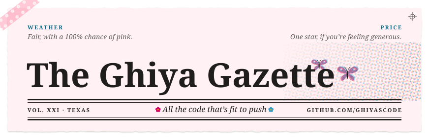
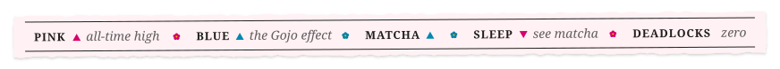
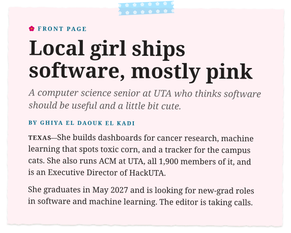
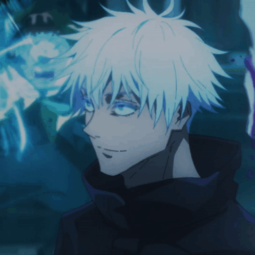
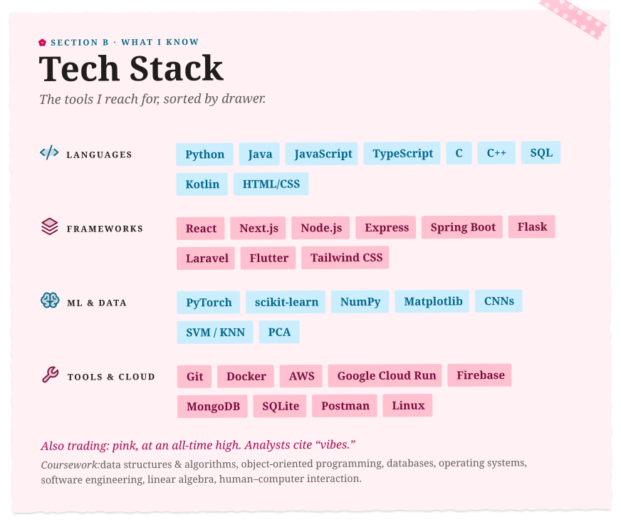
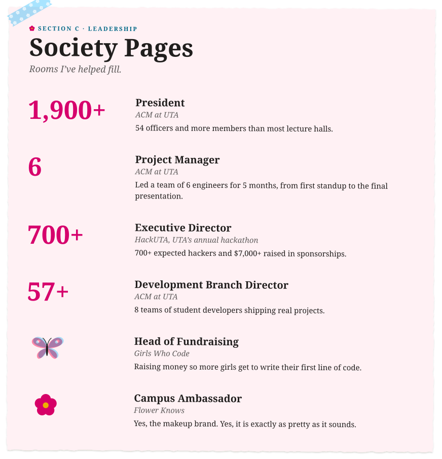
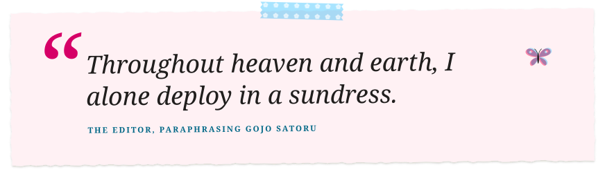
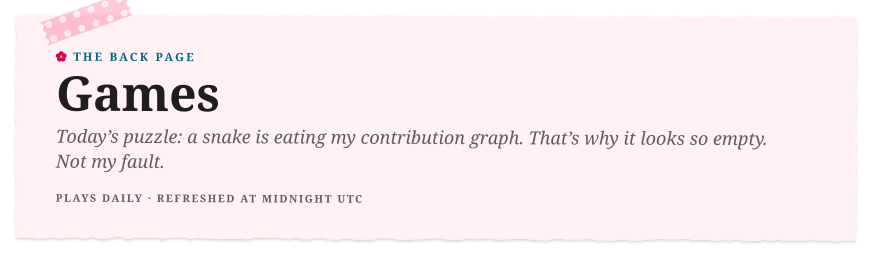
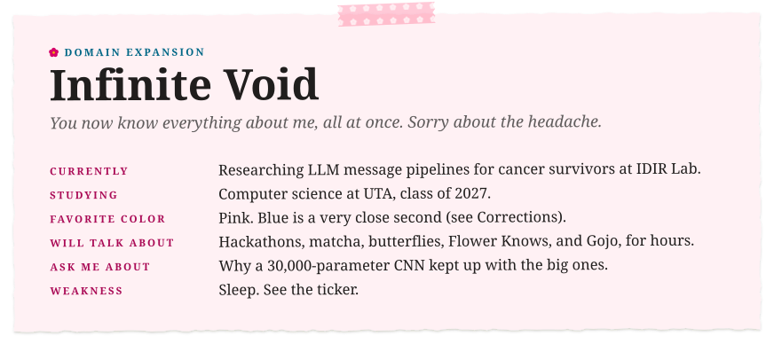
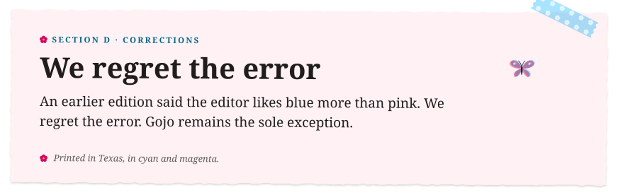

<!-- The Ghiya Gazette · every clipping lives in /assets · the snake is fed by .github/workflows/snake.yml -->

  
  

  
  

  <picture>
    <source media="(prefers-color-scheme: dark)" srcset="https://raw.githubusercontent.com/ghiyascode/ghiyascode/output/snake-dark.svg">
    
  </picture>

  
&nbsp;<b><i>Domain Expansion</i></b> &nbsp;·&nbsp; click to step inside

   
  

  <a href="https://ghiyascode.github.io">website</a> &nbsp;✿&nbsp; <a href="https://linkedin.com/in/ghiya-el-daouk">linkedin</a> &nbsp;✿&nbsp; <a href="https://github.com/ghiyascode">@ghiyascode</a>

